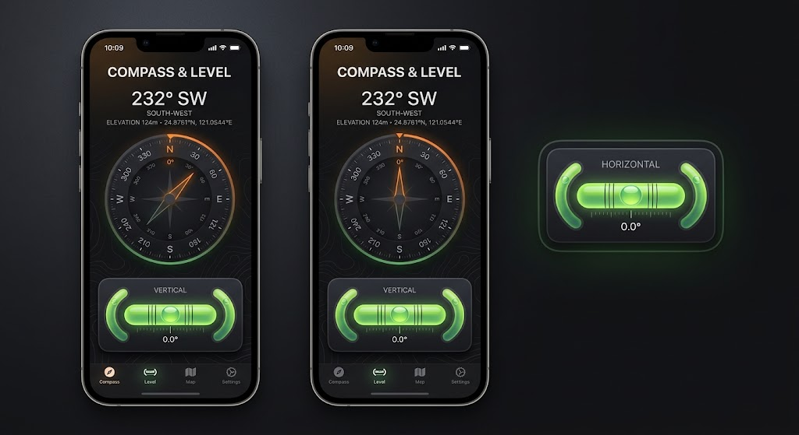

# JackCompass

以 **Kotlin + Jetpack Compose** 開發的 Android 工具箱 app：**指南針**與**水平儀**，
指南針畫面並附**經緯度**（GPS）讀值。

## 功能

| 工具 | 資料來源 | 說明 |
|---|---|---|
| 指南針 | `TYPE_ROTATION_VECTOR` | 大字方位角＋方位名，下方是會反向旋轉的羅盤盤面；指針固定朝上、指向正北時轉綠，度數每跨一度震動一格。顯示的是磁北方位，**未做磁偏角修正** |
| 水平儀 | `TYPE_ACCELEROMETER` | 水平／垂直兩種模式，氣泡管會跟著換方向 |
| 經緯度 | `LocationManager`（框架內建，無額外相依） | 顯示在指南針的大字度數與盤面之間，排版與小數點跟著語系走；還沒定位時顯示佔位，裝置沒有定位硬體時整列隱藏。**不含海拔、速度與地圖** |
| 橫幅廣告 | AdMob（GMA Next-Gen SDK） | 每次啟動只載入一次，錨在底部導覽列上方，顯示 30 秒後收起，這次執行不再出現；完全退出重開才會再跑一次。前提是先通過 Google 的廣告同意表單 |
| 贊助入口 | AdMob 全螢幕廣告 | 設定頁的「看廣告支持開發者」，看了只播感謝動畫，**不解鎖任何功能**；從這裡才會播插屏，其他時刻一律不自動播 |

介面是 2 個分頁（指南針／水平儀）＋ 1 個設定頁（右上齒輪進入：語系切換、贊助入口、調整廣告同意選項）。
語系有英文（預設）、繁體中文與簡體中文，在設定頁切換。

## 設計參考



`spec/prototype.jpg` 是最初的設計參考圖。盤面樣式（固定深色＋橘／綠）與水平儀的兩種模式已照圖實作，
其餘（分頁數量、指南針與水平儀是否同屏、地圖）刻意與設計圖不同；逐條差異記錄於
[`AGENTS.md`](AGENTS.md#原型落差)。

## 技術組合

| 項目 | 版本 |
|---|---|
| Android Gradle Plugin | 9.4.1 |
| Kotlin | 2.4.21 |
| Gradle | 9.6.0 |
| Compose BOM | 2026.09.00 |
| compileSdk / targetSdk | 37 |
| minSdk | 24 |
| JDK | 17 |
| UI 套件 | Jetpack Compose + Material 3 |
| 導覽 | Navigation Compose 2.10.2 |
| 非同步 | kotlinx-coroutines-android 1.10.2 |
| 語系切換 | androidx.appcompat 1.8.0（`AppCompatDelegate.setApplicationLocales`） |
| 廣告 | GMA Next-Gen SDK 1.5.0（`com.google.android.libraries.ads.mobile.sdk`） |
| 同意管理 | User Messaging Platform 4.0.0 |

> `applicationId` 是 `com.hywen.app.jackcompass`，但 `namespace` 與原始碼目錄仍是
> `com.wenhsiaoyi.jackcompass`——刻意不一致，不要把目錄 rename 過去。

> AGP 9.0 起 Kotlin 為**內建支援**，建置腳本刻意**不套用** `org.jetbrains.kotlin.android` plugin。
> 網路上多數教學仍會套用，照抄會導致建置失敗。

## 環境需求

- **JDK 17**（AGP 9.4 的最低與預設版本）
- **Android SDK**，需 platform 37（缺的元件 AGP 會在第一次建置時自動下載安裝）
- **Android Studio**（選用；AGP 9.0 起需 Otter 3 Feature Drop 或更新版本）

## 建置與執行

```powershell
.\gradlew.bat assembleDebug    # 產物：app/build/outputs/apk/debug/app-debug.apk
.\gradlew.bat installDebug     # 安裝至已連線的裝置或 emulator
.\gradlew.bat test             # JVM 單元測試（sensor/ 與 ads/ 的純函式）
.\gradlew.bat lint             # 靜態檢查
```

> **請務必使用 `.\gradlew.bat`，不要使用 PATH 上的 `gradle`。**
> 環境中 PATH 上的 Gradle 為 8.1.1，不支援 AGP 9.4 所需的 Gradle 9.6，會在載入 plugin 階段直接失敗。

第一次建置會下載 Gradle 與全部相依（實測約 12 分鐘），之後約 30 秒。

## 專案結構

```
app/src/main/java/com/wenhsiaoyi/jackcompass/
├── MainActivity.kt         單一 Activity 進入點（必須是 AppCompatActivity）
├── sensor/                 感測器與定位層，一律「純函式 ＋ Flow 包裝」兩截
│   ├── SensorMath.kt       方位角、傾角、濾波（無 Android 相依，JVM 可測）
│   ├── SensorFlows.kt      SensorManager → Flow
│   ├── LocationMath.kt     經緯度格式化、定位可用性判定（同上）
│   └── LocationFlow.kt     LocationManager → Flow
├── ads/                    廣告與贊助層，同樣「純函式 ＋ SDK 包裝」兩截
│   ├── BannerPolicy.kt     橫幅 30 秒生命週期的狀態機（無 Android 相依，JVM 可測）
│   ├── SponsorPolicy.kt    贊助入口 Hidden／Ready／Preparing／Playing／Unavailable 狀態機
│   ├── AdBootstrap.kt      MobileAds 初始化（只跑一次）
│   ├── AdMobBanner.kt      橫幅載入與交付 View
│   ├── AdMobInterstitial.kt 全螢幕廣告載入與播放
│   └── AdSession.kt        串同意鏈、兩個 policy 與 Compose 的可觀察狀態（process 層單例）
└── ui/
    ├── JackCompassApp.kt   Scaffold + 底部導覽列 + NavHost
    ├── components/         BannerSlot（導覽列上方的橫幅槽）、SponsorThanksOverlay（感謝動畫）
    ├── theme/              Material 3 主題、動態取色與盤面固定色板
    ├── compass/            指南針畫面（含經緯度列）
    ├── level/              水平儀畫面
    └── settings/           設定頁（語系切換、贊助入口、廣告同意選項）
```

原始碼置於 `src/main/java/`（AGP 內建 Kotlin 的預設路徑，同時相容 Java 檔案）。
語系檔在 `app/src/main/res/values/`、`values-zh-rTW/`、`values-zh-rCN/`。
新增工具分頁時，在 `ui/JackCompassApp.kt` 的 `ToolDestination` enum 增加一筆即可。

## 開發注意事項

環境陷阱、已驗證的建置限制與 agent 工作流程完整記錄於 [`AGENTS.md`](AGENTS.md)，其中幾點最容易踩到：

- Gradle 必須透過 wrapper 執行
- `JAVA_HOME`（JDK 17）與 PATH 上的 `java`（JDK 25）版本不同，**不可**用 `java -version` 判斷 build 實際使用的 JDK
- `local.properties` 內含機器專屬的 `sdk.dir`，已被 `.gitignore` 排除，**不可提交**
- `androidx.compose.material` 的 icon artifacts 已於 1.7.8 停止更新且不再隨 Compose BOM 帶入，本專案刻意不依賴；設定齒輪與啟動圖示都是自己畫的向量，底部導覽列則只有文字標籤
- 感測器與定位的 `uses-feature` 全部明寫 `required="false"`。少了這行，AGP 會因 `ACCESS_FINE_LOCATION` 自動把 `android.hardware.location` 標成必要，沒有定位硬體的裝置裝不上，經緯度的「無硬體就隱藏」也永遠走不到
- `android.location.LocationListener` 有三個回呼到 API 30 才變成 default 方法，`LocationFlow.kt` 把它們補齊不是冗餘程式碼——縮成 lambda 在 API 24–29 會當
- `.\gradlew.bat lint` 目前會報 3 個 error（震動用的 API 要 26 但 minSdk 是 24、`app_name` 未翻譯成中文），是尚未處理的既有問題
- **開發期間不要點自己的廣告**，AdMob 會判定無效流量、嚴重者停權。廣告 ID 分兩份資源：正式 ID 只在 `app/src/main/res/values/ads.xml`，`app/src/debug/res/values/ads.xml` 覆寫成 Google 官方測試 ID 並把除錯地區強制設為 EEA，所以 debug 構型看得到同意表單、release 不會

## License

尚未授權。
